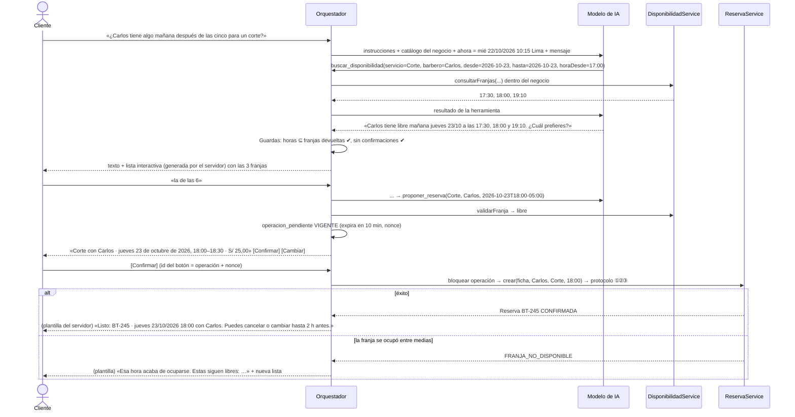

# BarberTurno v2 · 06 · Flujos de alta, invitaciones y WhatsApp

> Estado: propuesta · 21/10/2026. Reglas citadas en `02-requisitos.md`; permisos en `05-roles-permisos.md`; tablas en `04-arquitectura-datos.md` §3.

## 1. Alta de una barbería
```mermaid
sequenceDiagram
  actor AP as Admin. plataforma
  participant API as /api/plataforma
  participant DB as PostgreSQL
  actor P as Futuro propietario
  AP->>API: POST /negocios {nombre, slug, correoPropietario}
  API->>DB: INSERT negocio + INSERT invitacion(PROPIETARIO, token_hash, expira 7 días) — una transacción
  API-->>AP: 201 {negocio, enlaceInvitacion (se muestra una sola vez)}
  AP-->>P: Comparte el enlace por un canal propio (en el MVP no se envía correo, P2-04)
  P->>API: GET /api/invitaciones/{token} → negocio, rol y correo enmascarado
  P->>API: login o registro con ese correo → POST /api/invitaciones/{token}/aceptacion
  API->>DB: invitación PENDIENTE, vigente y correo = usuario.correo → membresía PROPIETARIO ACTIVA; invitación ACEPTADA
  API-->>P: 200 → redirige a /n/{slug}/agenda
```
- El negocio existe desde el alta, pero **sin propietario activo** no admite reservas ni canal de WhatsApp (estado operativo «pendiente de propietario», derivado de que no haya membresías). Es la única excepción temporal a V2-RN-06 y se resuelve al aceptar.
- Si el correo invitado no coincide con el de la cuenta → 404 genérico (no se revela a quién iba dirigida).
- Token: 32 bytes aleatorios en Base64URL; en la base solo su SHA-256; un solo uso; 7 días; revocable por la plataforma (propietario) o por el negocio (resto).

## 2. Invitaciones del equipo
| Paso | Regla |
|---|---|
| Invitar | Propietario: cualquier rol. Encargado: `ENCARGADO` o `BARBERO`. Si el rol es `BARBERO`, la invitación puede asociarse a un perfil `barbero` ya creado (con su horario) y al aceptar se rellena `barbero.usuario_id`. Una invitación pendiente por correo y negocio (`invitacion_pendiente_uk`). |
| Aceptar | Mismo flujo que el §1. Si la persona ya tiene membresía en el negocio → 409 `YA_ES_MIEMBRO`. |
| Revocar invitación | Pasa a `REVOCADA`; el enlace deja de servir en el acto. |
| Cambiar rol | Solo el propietario. Degradar al último propietario → 409 `ULTIMO_PROPIETARIO`. |
| Revocar membresía | `REVOCADA`; efecto inmediato en la siguiente petición (la membresía se revalida siempre). Si era `BARBERO`, el perfil se desactiva con la regla de v1 (avisa de reservas futuras vigentes). La cuenta global no cambia (V2-RN-16). |
| Salir del negocio | Igual que revocar la propia; el último propietario no puede salir. |
| Último propietario | `pg_advisory_xact_lock(313131, negocio_id)` → contar propietarios activos excluyendo el afectado → si quedaría 0, rechazar. Dos propietarios que se revocan a la vez: el segundo espera, recuenta y es rechazado (V2-CP-04). |
| Transferir la propiedad | Invitar o ascender a otro propietario y, después, degradarse o salir. |

## 3. Recuperación de acceso (MVP, sin correo)
| Quién | Cómo |
|---|---|
| Propietario | Lo restablece el administrador de la plataforma (contraseña temporal, `debe_cambiar_password`, se audita). |
| Equipo y clientes web | El propietario o encargado restablece **si la cuenta no tiene relación con otros negocios** (V2-RN-16); si la tiene, el sistema responde «Solicítalo a soporte de la plataforma» sin revelar en qué otros negocios está. |
| Cliente con ficha vinculada a WhatsApp | Escribe «olvidé mi contraseña» al número del negocio → enlace de un solo uso (15 min) en el chat → fija una contraseña nueva (Fase 3, V2-RF-18). |
| Futuro | Recuperación por correo cuando se apruebe el proveedor (P2-04). |

## 4. Navegación con varios negocios
1. Tras el login, `GET /api/mis-negocios` devuelve las membresías y fichas activas: `[{slug, nombre, rol | "CLIENTE"}]`.
2. Con una sola relación se entra directamente (`/n/{slug}/agenda` el personal, `/n/{slug}/reservar` el cliente); con varias, pantalla de selección; el administrador de la plataforma ve además «Plataforma».
3. Cambiar de negocio = navegar a otra URL `/n/{slug}`: el frontend cancela las peticiones del negocio anterior y vacía su estado (auditoría 075 §8). El servidor no guarda un «negocio actual».
4. Página pública `/n/{slug}`: servicios, profesionales y disponibilidad sin cuenta; reservar exige cuenta y crea la ficha del cliente si no existe (con aceptación de privacidad).

## 5. Conexión del número de WhatsApp
| Fase | Flujo |
|---|---|
| 1 (desarrollo) | La plataforma registra en `canal_whatsapp` el número de prueba de Meta asociado al negocio de prueba. Token y *app secret* en variables de entorno. Sin coste por mensaje hacia los destinatarios de prueba. |
| 3 (piloto) | El propietario pulsa «Conectar WhatsApp» → Embedded Signup v4 (SDK de JavaScript de Meta en una página de mismo origen, con el dominio en *Allowed domains*) → el navegador recibe un código → `POST /api/n/{slug}/whatsapp/conexion {codigo, wabaId, phoneNumberId}` → el servidor intercambia el código por un *business token*, registra el número en la Cloud API, suscribe la app a los *webhooks* de esa cuenta, crea las plantillas *utility* y guarda el token cifrado. El negocio añade su método de pago en su cuenta de mensajería de Meta (paga sus mensajes). |
| Desconexión | El propietario desconecta → `DESCONECTADO`; los mensajes que lleguen a ese número se descartan con registro. |

## 6. WhatsApp: primer contacto y consentimiento
```mermaid
sequenceDiagram
  actor C as Cliente
  participant M as Meta
  participant W as Webhook + cola
  participant O as Orquestador
  participant DB as PostgreSQL
  C->>M: «Hola, quiero un corte»
  M->>W: POST /api/whatsapp/webhook (firmado)
  W->>DB: evento PENDIENTE (idempotente) → 200
  W->>O: negocio por phone_number_id; ficha por wa_id → no existe
  O->>DB: crea conversación (sin ficha definitiva todavía)
  O-->>C: «Hola, soy el asistente de reservas de Barbería X. Para reservar guardaremos tu nombre y número. Aviso de privacidad: <enlace>. ¿Aceptas?» [Aceptar] [No, gracias]
  C->>O: [Aceptar]
  O->>DB: crea ficha (wa_id, nombre del perfil de WhatsApp o el que indique, privacidad_aceptada_en)
  O-->>C: continúa con la intención del primer mensaje
```
- Sin aceptación no se crea la ficha ni se reserva; sí se puede consultar el catálogo y la disponibilidad.
- El opt-in para **recordatorios** es una pregunta aparte después de la primera reserva («¿Quieres que te recordemos la cita un día antes?»); se guarda `whatsapp_optin_en`. «BAJA» o «STOP» lo retira (`whatsapp_optout_en`) y se confirma.

## 7. WhatsApp: reservar
### 7.1 Guiado (Fase 1, también respaldo de la IA)
Menú principal (botones): **Reservar** · **Mis citas** · **Hablar con alguien**. Reservar → lista de servicios → lista de profesionales («Cualquiera» incluido, RF-21) → elegir día (hoy, mañana, próximos 5 días) → lista de franjas (máx. 10; «ver más») → **resumen + [Confirmar] [Cambiar]** → resultado.

### 7.2 Con IA (Fase 2)

Claves: el modelo **nunca** ejecuta la reserva; la confirmación es la pulsación del botón (o un «sí» escrito cuando hay una única operación vigente, que el servidor reconoce sin IA, V2-RN-10); el mensaje de éxito lo compone el servidor (V2-RN-11).

### 7.3 Aclaraciones y conflictos
| Situación | Comportamiento |
|---|---|
| Falta el servicio o el profesional, o es ambiguo («algo rápido») | Pregunta con opciones del catálogo (lista). |
| «El viernes» cuando hoy es viernes; «a las 5» (¿05:00 o 17:00?) | Pregunta mostrando las dos lecturas con fecha completa. |
| El profesional pedido no existe o está inactivo | Lo dice y ofrece los activos. |
| No hay franjas en el rango | Lo dice y ofrece el día siguiente con franjas o «Cualquier profesional». |
| Cliente con 3 reservas activas (RN-20) o solapada (RN-04) | Se detecta al **proponer**; mensaje del servidor con el código de error traducido. |
| Operación caducada o ya usada | «Esa propuesta ya no es válida» + nueva búsqueda. |
| Dos mensajes seguidos sin progreso, queja, tema ajeno o «hablar con alguien» | Derivación (§9). |

## 8. WhatsApp: mis citas, cancelar y reprogramar
- **Mis citas:** lista de reservas futuras de la ficha con fecha completa; cada una con botones según `permisos` (los calcula el servidor, DA-15).
- **Cancelar:** elegir cita → `proponer_cancelacion` comprueba RN-07 (≥ 2 h) → resumen + [Sí, cancelar] [No] → `ReservaService.cancelar` con la `version` guardada en la operación → plantilla de resultado. Con menos de 2 h: «Ya no se puede cancelar por aquí; ¿quieres que te pase con el equipo?».
- **Reprogramar:** elegir cita → nueva búsqueda con `excluirReservaId` (DA-21: misma duración de referencia) → resumen del cambio (antes → después) → confirmación → `ReservaService.reprogramar`. Si falla, la cita original queda intacta (RN-09).

## 9. Derivación a una persona y bandeja
1. Disparadores: botón «Hablar con alguien», petición en texto, herramienta `derivar_a_persona`, límites superados (V2-RN-14) o error repetido.
2. `conversacion.modo = HUMANO`; aviso interno a propietarios y encargados; respuesta del sistema: «Te paso con el equipo de Barbería X. Te responderán en su horario de atención (…)».
3. Bandeja web (`/n/{slug}/whatsapp`): conversaciones en modo humano con su historial; responder texto libre **dentro de la ventana de 24 h** (fuera de ella, el botón queda deshabilitado con la explicación); «Devolver al asistente».
4. Mientras está en modo humano el asistente no responde (V2-RN-15). Tras 24 h sin actividad del personal, vuelve sola al asistente con aviso.

## 10. Entrega fallida y duplicados
| Caso | Tratamiento |
|---|---|
| *Webhook* repetido por Meta | `evento_whatsapp_clave_uk` → se ignora; respuesta 200. |
| Doble pulsación de [Confirmar] | La primera bloquea y ejecuta la operación (`EJECUTADA`); la segunda la encuentra ejecutada y repite la misma respuesta, sin crear otra reserva. |
| Error transitorio de la Graph API (429, 5xx, red) | Reintento con espera exponencial (5 intentos en ~15 min). |
| Error permanente (número no válido, ventana cerrada, plantilla rechazada) | `FALLIDO` + aviso interno al personal con la reserva afectada. **La operación no se deshace.** |
| Aviso de estado `failed` de Meta | Igual que un error permanente. |
| Número receptor desconocido | Evento `DESCARTADO`, registro sin contenido. |
| Mensaje que no es texto ni botón (audio, imagen, ubicación) | «Por ahora solo entiendo texto y botones» + menú. |
